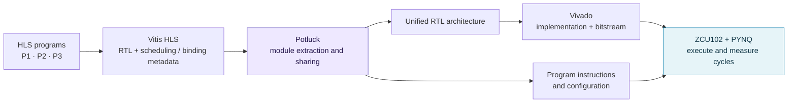

<div align="center">

# Potluck

### High-Level Synthesis for Architectural Design<br>via Automated Module Extraction and Sharing

**Share hardware. Switch programs with instructions.**

[](https://doi.org/10.5281/zenodo.21542987)
[](#requirements)
[](requirements.txt)
[](LICENSE)

[Get started](#get-started) · [Build experiments](#build-the-experiments) · [Run on FPGA](#run-on-the-zcu102) · [Evaluate results](#evaluate-the-results) · [Artifact archive](https://doi.org/10.5281/zenodo.21542987)

</div>

---

Potluck transforms related HLS accelerator designs into a **shared, instruction-controlled FPGA architecture**. It extracts modules and control information from Vitis HLS outputs, generates a unified RTL design, and produces the instructions and configuration files needed to execute each input program on that design.

This repository accompanies the **MICRO 2026 Potluck paper**. It includes the compiler workflow, eight benchmark families, standalone and manually designed comparison architectures, and PYNQ deployment examples for the AMD/Xilinx ZCU102. The artifact evaluation targets the core results in **Tables III and IV**: resource utilization, timing, execution cycles, and derived latency.

> **Choose your route:** use the supplied FPGA bundles to explore execution on a ZCU102, or rebuild the designs with Vitis HLS and Vivado to collect implementation results. Before running the supplied Python deployment files, apply the [documented syntax repair](#prepare-the-deployment-scripts) to a working copy.

## Contents

- [How Potluck works](#how-potluck-works)
- [Get started](#get-started)
- [Requirements](#requirements)
- [Installation](#installation)
- [Benchmarks and experiment coverage](#benchmarks-and-experiment-coverage)
- [Build the experiments](#build-the-experiments)
- [Build one design step by step](#build-one-design-step-by-step)
- [Run on the ZCU102](#run-on-the-zcu102)
- [Evaluate the results](#evaluate-the-results)
- [Repository guide](#repository-guide)
- [Troubleshooting](#troubleshooting)
- [Scope and support](#scope-and-support)
- [Citation and license](#citation-and-license)

## How Potluck works



For a given benchmark and unroll factor, Potluck combines three programs into one architecture. Program-specific instructions select the computation and data movement on the shared hardware. The resulting architecture is intended to reuse common modules and support the programs without rebuilding a separate bitstream for every program.

The repository compares three approaches:

| Approach | Input | Hardware produced for each benchmark/unroll setting |
| --- | --- | --- |
| **Potluck** | Three HLS programs plus BRAM and AXI mappings | One automatically generated unified architecture, with per-program instructions |
| **Manual architecture** | An explicitly written shared HLS architecture | One manually designed architecture |
| **Standalone baseline** | Each of the three programs separately | Three independent accelerator designs |

**Naming note:** `ArchHLS` is the earlier name retained in script filenames and some internal documentation. The `run_ArchHLS_*.sh` entrypoints implement the Potluck flows described here.

## Get started

Clone the repository on your build host, or obtain the archived artifact from [Zenodo](https://doi.org/10.5281/zenodo.21542987):

```bash
git clone https://github.com/sharc-lab/Potluck.git
cd Potluck
```

You can inspect all experiment plans before installing the FPGA tools:

```bash
# 24 unified-architecture builds.
./run_all_potluck_zcu102_experiments.sh --dry-run

# 72 standalone baseline builds + 24 manual-architecture builds.
./run_all_potluck_zcu102_manual_baseline.sh --dry-run

# 72 program executions using the supplied Potluck deployment scripts.
bash Potluck_FPGA/run_all_py.sh --dry-run
```

These dry runs inspect the plans without launching synthesis, creating run outputs, or accessing an FPGA. They do not validate the tools, board, or numerical results.

| Your goal | Start here | Needed |
| --- | --- | --- |
| Understand the implementation | [Repository guide](#repository-guide) | Source checkout |
| Run supplied Potluck designs | [Run on the ZCU102](#run-on-the-zcu102) | ZCU102 with a working PYNQ image |
| Rebuild the full experiment matrix | [Installation](#installation), then [batch builds](#build-the-experiments) | Licensed AMD tools and build-host dependencies |
| Follow one design end to end | [Conv + Act walkthrough](#build-one-design-step-by-step) | Build host; ZCU102 for execution |

## Requirements

Builds run on an **x86-64 Linux host**. Hardware execution runs on the **ZCU102's PYNQ environment**. Installing the Python packages on the host alone does not provide a board runtime.

| Component | Artifact evaluation environment / requirement |
| --- | --- |
| FPGA | AMD/Xilinx **ZCU102**, device `xczu9eg-ffvb1156-2-e` |
| Build-host OS | Red Hat Enterprise Linux **8.10**, x86-64 |
| Recorded Linux kernel | `4.18.0-553.129.1.el8_10.x86_64` |
| FPGA toolchain | **Vivado and Vitis HLS 2024.1.2**, with device support and a license suitable for ZCU102 |
| Python | **3.9.16**; the batch runners create `Potluck_env` with this version |
| Verilog preprocessing | **Icarus Verilog 13.0**, including `iverilog` on `PATH` |
| Python packages | `numpy==1.23.5`, `Jinja2==3.1.2`, `pyverilog==1.3.0`, `pynq==3.0.1` |
| Board software | A bootable, ZCU102-compatible PYNQ environment with permission to program the FPGA and allocate buffers |
| Disk space | Approximately **400 GB** for the full evaluation workflow |
| Preparation time | Approximately **1 day** |
| Full experiment time | Approximately **3 days** |

The time and storage estimates come from the artifact appendix; actual requirements depend on the machine, existing HLS outputs, and build concurrency. The tested package pins are in [requirements.txt](requirements.txt).

## Installation

### 1. Set up the AMD tools on the build host

Install Vivado and Vitis HLS using the [AMD installation guide](https://docs.amd.com/r/2024.1-English/ug973-vivado-release-notes-install-license/Download-the-Installation-File). Include the Zynq UltraScale+ device support needed by the ZCU102 and configure your tool license.

Source the settings scripts from your actual installation. For example, a 2024.1 installation updated to the required patch release may use paths such as:

```bash
# Replace these example paths with your installation paths.
source /path/to/Xilinx/Vivado/2024.1/settings64.sh
source /path/to/Xilinx/Vitis/2024.1/settings64.sh

command -v vivado vitis_hls
vivado -version
vitis_hls -version
```

### 2. Create the Python environment

From the repository root, with Conda available in your shell:

```bash
conda create -y -n Potluck_env python=3.9.16 pip
conda activate Potluck_env
python -m pip install -r requirements.txt
python -m pip check
```

The batch build scripts create this environment and install the requirements automatically **only if the environment does not already exist**. If it already exists, install or refresh the requirements yourself using the commands above.

PYNQ is also needed on the build host: [gen_xclbin.py](Potluck_Final/gen_xclbin.py) uses its hardware-description parser to produce `.xclbin` metadata.

### 3. Install Icarus Verilog

Follow the [Icarus Verilog build instructions](https://github.com/steveicarus/iverilog#compiling-from-release) for the version used by the artifact, then check:

```bash
iverilog -V
python -c 'import numpy, jinja2, pyverilog, pynq; print("Python dependencies import successfully")'
```

Pyverilog invokes the Icarus preprocessor, so installing `pyverilog` without an accessible `iverilog` executable is insufficient.

### 4. Prepare the ZCU102 for execution

Boot a ZCU102-compatible PYNQ image and make the board accessible over your network. The artifact appendix points to the [PYNQ getting-started guide](https://pynq.readthedocs.io/en/v3.1/getting_started.html) and [SD-card image build guide](https://pynq.readthedocs.io/en/v3.1/pynq_sd_card.html). Use an image appropriate for **ZCU102**; the image documentation version and the pinned Python package version are separate choices.

Run deployment commands in the board's PYNQ Python environment, with the board permissions required by that image. Verify that `from pynq import Overlay, allocate, MMIO` succeeds there before proceeding.

<details>
<summary><strong>Using a custom Python environment for individual build scripts</strong></summary>

All `run_ArchHLS*.sh` entrypoints accept the following options:

| Option | Purpose |
| --- | --- |
| `--conda-env NAME` | Activate a named Conda environment |
| `--conda-prefix PATH` | Activate an environment by its path |
| `--conda-sh PATH` | Use a nonstandard `conda.sh` location |
| `--no-conda` | Use the Python environment already active in the shell |

Equivalent variables are `POTLUCK_CONDA_ENV`, `POTLUCK_CONDA_PREFIX`, `POTLUCK_CONDA_SH`, and `POTLUCK_USE_CONDA=0`.

**Always pass `--conda-env Potluck_env` in direct invocations**, or select another environment explicitly. The shared helper still defaults to the legacy environment name `INR_pytorch`; the batch scripts already override it. These environment-selection options belong to the individual build entrypoints, not to the two root-level batch runners.

</details>

## Benchmarks and experiment coverage

Each benchmark has three programs, **P1, P2, and P3**. An unroll factor selects a different degree of parallelism in the HLS design.

| Benchmark | Directory name | Potluck / baseline unroll factors | Manual unroll factors | Vivado target |
| --- | --- | --- | --- | --- |
| Conv + Act | `conv_act` | 1, 4, 16 | 1, 4, 16 | 100 MHz |
| DNN Block | `DNN_block` | 1, 4, 8 | 1, 4, 8 | 100 MHz |
| Attention Module | `attention_module` | 1, 4, 32 | 1, 4, 32 | 100 MHz |
| MoE Layer | `moe_layer` | 1, 4, 32 | **1, 4, 16** | 100 MHz |
| Streaming Bench-1 | `streaming_bench_1` | 1, 4, 32 | 1, 4, 32 | 100 MHz |
| Streaming Bench-2 | `streaming_bench_2` | 16, 32, 64 | 16, 32, 64 | 100 MHz |
| High Frequency Bench-1 | `high_frequency_bench_1` | 4, 16, 64 | 4, 16, 64 | 250 MHz |
| High Frequency Bench-2 | `high_frequency_bench_2` | 4, 32, 64 | 4, 32, 64 | 250 MHz |

These are the configurations selected by the batch scripts. In particular, the manual MoE design uses unroll 16 where the Potluck and standalone sets use 32. The target frequency selects the Vivado implementation flow; use the implemented clock and timing report when calculating results.

| Design set | Build jobs | Supplied board bundles |
| --- | --- | --- |
| Potluck | 8 benchmarks × 3 unroll settings = **24** | All 24 settings, with 3 Python programs each |
| Manual architectures | 8 × 3 = **24** | Streaming Bench-1 and Bench-2 |
| Standalone baselines | 8 × 3 × 3 programs = **72** | Streaming Bench-1 and Bench-2 |

## Build the experiments

Run the following commands **from the repository root on the build host**, after installation. All batch builds enable `--debug`, which adds the cycle-counting hardware needed for the execution measurements.

### Potluck unified architectures

```bash
./run_all_potluck_zcu102_experiments.sh -j2 --keep-going \
  --run-id potluck-eval
```

For each benchmark/unroll setting, the runner prepares P1/P2/P3 with Vitis HLS if the required outputs are missing, creates an isolated copy of `Potluck_Final`, writes the HLS solution-path list, and runs the appropriate 100 MHz or 250 MHz flow. Existing HLS outputs that pass its file checks are reused; this is not a source-change-aware rebuild system.

### Manual architectures

```bash
./run_all_potluck_zcu102_manual_baseline.sh -j2 \
  --designs manual_arch --keep-going --run-id manual-eval
```

### Standalone baselines

```bash
./run_all_potluck_zcu102_manual_baseline.sh -j2 \
  --designs baseline --keep-going --run-id baseline-eval
```

Omit `--designs` to build both comparison sets in one invocation. This runner copies synthesized RTL into each job's workspace before adding debug ports, derives the AXI interface list from `top.v`, and determines the manual architecture's instruction width from its C++ definition.

### Control the workload

| Option | Applies to | Behavior |
| --- | --- | --- |
| `--dry-run` | Both build runners | Print the selected plan without running tools |
| `-j N` / `--jobs N` | Both | Run up to N complete design builds concurrently; default 1 |
| `--keep-going` | Both | Continue launching jobs after failures and record their status |
| `--run-id NAME` | Both | Give the run a recognizable directory name; default is a timestamp |
| `--force` | Both | **Delete existing run/Vivado directories for the selected run ID** before rebuilding |
| `--designs baseline,manual_arch` | Manual/baseline runner | Select comparison design sets |
| `--baseline-phases 1,2,3` | Manual/baseline runner | Select baseline programs |
| `--max-jobs N` | Manual/baseline runner | Launch only the first N selected jobs |
| `--max-jobs-per-design N` | Manual/baseline runner | Limit baseline and manual job counts separately |

A small comparison-build trial, after inspecting its plan:

```bash
./run_all_potluck_zcu102_manual_baseline.sh --dry-run \
  --max-jobs-per-design 1
./run_all_potluck_zcu102_manual_baseline.sh -j1 \
  --max-jobs-per-design 1 --keep-going --run-id comparison-trial
```

`-j2` means two complete builds, not two CPU threads. The shipped bitstream Tcl scripts request `launch_runs ... -jobs 64` internally. Choose concurrency for your host's CPU, memory, and license capacity; adjust that Tcl setting if necessary. Use a fresh run ID for another attempt. `--force` removes the chosen run's outputs but does not force resynthesis of cached HLS projects.

### Find the outputs and logs

```text
Potluck_AE_Runs/<run-id>/
├── summary.csv
├── logs/<benchmark>_unroll_<N>.log
└── Potluck_Final_<benchmark>_unroll_<N>/
    ├── architecture_design_RTL/       # Generated unified Verilog
    ├── FPGA_deploy/                   # gen_architecture.bit/.hwh/.xclbin
    ├── configuration_inst_generate/   # Program instruction text files
    ├── configuration_JSON/            # Includes config.json
    └── program_tree/                  # Includes mapping_table_1/2/3.json

Vivado_project/<run-id>/<benchmark>_unroll_<N>/
└── automatic_gen_bitstream_debug/
    └── automatic_gen_bitstream.xpr
```

Comparison build logs and workspaces are under `Potluck_AE_Manual_Baseline_Runs/<run-id>/`. Their Vivado projects are under:

```text
Vivado_project/<run-id>/manual_baseline/<design>/<benchmark>/unroll_<N>/<phase>/
```

Here `<design>` is `baseline` or `manual_arch`, and `<phase>` is `p1`, `p2`, `p3`, or `manual`. Each `summary.csv` records status, timing, workspace, Vivado path, and log path; the comparison summary also records the copied RTL path. A `PASS` reports successful completion of the build commands. Check the implementation reports separately for achieved timing and resource usage.

## Build one design step by step

This example builds **Conv + Act, unroll 1**, combining P1, P2, and P3. Run it on the build host after [installation](#installation). Keep the same shell for the commands below so the path variables remain defined.

### 1. Synthesize the input programs

From the repository root:

```bash
POTLUCK_ROOT="$PWD"

(
  cd "$POTLUCK_ROOT/Potluck_Benchmark/conv_act" || exit 1
  for p in 1 2 3; do
    vitis_hls -f "run_hls_p${p}_unroll_1.tcl" || exit 1
  done
)
```

These Tcl files run C simulation and HLS synthesis. Other benchmark scripts may also run RTL co-simulation. The supplied HLS scripts use `open_project -reset`, so invoking them explicitly recreates their named projects.

Potluck reads the following files from **each complete HLS solution**, not just the exported IP:

```text
solution1/
├── .autopilot/db/design.bindinfo.xml
├── .autopilot/db/top.adb.xml
└── impl/verilog/
    ├── top.v
    └── ... other generated Verilog files
```

Some Tcl files leave `export_design` disabled and produce RTL only under `syn/verilog`. After successful synthesis, prepare the expected location as the batch runner does:

```bash
for p in 1 2 3; do
  solution="$POTLUCK_ROOT/Potluck_Benchmark/conv_act/project_conv_act_p${p}_unroll_1/solution1"
  if [ ! -f "$solution/impl/verilog/top.v" ]; then
    mkdir -p "$solution/impl/verilog"
    cp -a "$solution/syn/verilog/." "$solution/impl/verilog/"
  fi
done
```

### 2. Create a workspace and describe the inputs

Use a fresh workspace because the compiler writes generated files relative to its working directory:

```bash
POTLUCK_RUN="$(mktemp -d "$POTLUCK_ROOT/Potluck_single_XXXXXX")"
cp -a "$POTLUCK_ROOT/Potluck_Final" "$POTLUCK_RUN/work"
mkdir -p "$POTLUCK_RUN/vivado"
cd "$POTLUCK_RUN/work"

for p in 1 2 3; do
  printf '%s\n' "$POTLUCK_ROOT/Potluck_Benchmark/conv_act/project_conv_act_p${p}_unroll_1/solution1/"
done > HLS_project_solution_path_conv_act_unroll_1.txt
```

The direct Potluck entrypoint takes four positional arguments:

| Argument | Meaning |
| --- | --- |
| Vivado project root | Directory for IP packaging and implementation outputs |
| HLS solution-path list | One solution directory per line, in P1/P2/P3 order; **include the trailing `/`** |
| BRAM-name JSON | Original on-chip buffer names for each program |
| AXI-interface mapping JSON | Mapping from functional modules to off-chip memory interfaces |

For this example, use the supplied [BRAM configuration](Potluck_Final/BRAM_name_conv_act.json) and [AXI mapping](Potluck_Final/axi_interface_mapping_conv_act.json). Absolute solution paths avoid ambiguity when copying the compiler to a new workspace. Relative paths are resolved from the directory where the compiler runs.

### 3. Generate the architecture and bitstream

```bash
./run_ArchHLS_zcu102.sh --debug --conda-env Potluck_env \
  "$POTLUCK_RUN/vivado" \
  HLS_project_solution_path_conv_act_unroll_1.txt \
  BRAM_name_conv_act.json \
  axi_interface_mapping_conv_act.json
```

For either high-frequency benchmark, prepare its matching solutions and JSON files, and use `run_ArchHLS_zcu102_high_frequency.sh` with the same argument structure. Keep `--debug` when collecting FPGA cycle counts.

The generated deployment files are now in `$POTLUCK_RUN/work/FPGA_deploy/`; instructions and JSON mappings are in the sibling output directories described above. Continue with [deploying a rebuilt design](#deploy-a-rebuilt-potluck-design).

<details>
<summary><strong>Direct manual-architecture and baseline entrypoints</strong></summary>

These scripts take two positional arguments: the Vivado project root and a **copied RTL directory** such as `solution1/syn/verilog`.

| Design | 100 MHz entrypoint | 250 MHz entrypoint |
| --- | --- | --- |
| Standalone | `run_ArchHLS_zcu102_baseline.sh` | `run_ArchHLS_zcu102_baseline_high_frequency.sh` |
| Manual | `run_ArchHLS_zcu102_baseline_arch.sh` | `run_ArchHLS_zcu102_baseline_arch_high_frequency.sh` |

Example syntax, from an isolated copy of `Potluck_Final`:

```bash
./run_ArchHLS_zcu102_baseline.sh --debug --conda-env Potluck_env \
  /absolute/path/to/vivado_project /absolute/path/to/copied/syn/verilog
```

Before running directly, populate `m_axi_interface_baseline.txt` for a standalone design, or `m_axi_interface.txt` and `inst_length.txt` for a manual architecture. The interface names must match the copied `top.v`, and the instruction width must match the manual design's `DATA_TYPE_INST`. The debug flow patches the supplied `top.v` in place. The batch runner handles these preparation steps automatically and is the easiest way to build the comparison sets.

</details>

## Run on the ZCU102

The commands in this section run **on the board**, except where explicitly labeled as packaging on the build host. Copy or clone the relevant repository directories onto the board while preserving their contents and relative paths. Use the board's PYNQ Python environment.

### Prepare the deployment scripts

The current artifact contains two Python syntax issues: some files place `from __future__ import annotations` after ordinary imports, and the supplied baseline/manual scripts contain `rom pynq import MMIO` instead of `from pynq import MMIO`. Repair these in a working copy before execution.

From the repository root on the board, create the Potluck working copy:

```bash
mkdir -p fpga_workspace
cp -a Potluck_FPGA fpga_workspace/

# Optional: also prepare the supplied streaming comparison designs.
# cp -a Potluck_Baseline_FPGA Potluck_Manual_Arch_FPGA fpga_workspace/
```

Run this once after copying the desired directories. It changes only those two syntax patterns in the deployment copies and checks that every copied script compiles:

```bash
python - <<'PY'
from pathlib import Path

root = Path("fpga_workspace")
scripts = sorted(root.rglob("*.py"))
assert scripts, "Copy the deployment directories into fpga_workspace first"
for path in scripts:
    original = path.read_text()
    lines = original.splitlines(keepends=True)
    future = [line for line in lines if line.startswith("from __future__ import ")]
    body = [line for line in lines if not line.startswith("from __future__ import ")]
    repaired = "".join(future + body).replace(
        "\nrom pynq import MMIO", "\nfrom pynq import MMIO"
    )
    compile(repaired, str(path), "exec")
    if repaired != original:
        path.write_text(repaired)
print(f"Syntax checked: {len(scripts)} deployment scripts")
PY
```

This check does not load a bitstream or validate hardware behavior. Run it again if you later copy in the optional comparison scripts.

### Run one supplied Potluck design

From the repository root on the board, after preparing the working copy:

```bash
cd fpga_workspace/Potluck_FPGA/conv_act/unroll_1
python conv_act_unroll_1_p1.py
python conv_act_unroll_1_p2.py
python conv_act_unroll_1_p3.py
```

Run each script **from its own directory**. It loads the local overlay, reads the matching configuration and input data, loads instructions, executes the selected program, and prints a line in this format:

```text
Cycle count = <measured value> ap_clk cycles
```

The Potluck host scripts also save output arrays under `configuration_output_program_<N>/`. Keep the `.bit`, `.hwh`, `.xclbin`, instructions, and configuration together as one matching bundle.

### Run all supplied Potluck programs

From `fpga_workspace/Potluck_FPGA` on the board:

```bash
./run_all_py.sh --dry-run
./run_all_py.sh --verbose
```

The runner discovers all **72 Python scripts**, executes them sequentially from their own directories, and writes:

```text
run_logs/<timestamp>/
├── summary.tsv           # status, elapsed seconds, script, log path
└── ... per-script logs
```

By default it attempts all scripts and returns a nonzero exit status if any fails. Use `--fail-fast` to stop on the first failure, `--python /path/to/python` to select the board interpreter, or `--logs-dir /path/to/logs` to choose another log location. `--verbose` displays the cycle-count output as well as saving it. Run hardware jobs sequentially on a single board because they reprogram the same FPGA.

### Deploy a rebuilt Potluck design

**On the build host**, assemble a new bundle using files from the same successful build. For the single-design walkthrough, set:

```bash
# Run this packaging block from the repository root.
POTLUCK_ROOT="$PWD"
POTLUCK_BUILD="$POTLUCK_RUN/work"
# For a batch build or a new shell, replace the line above with the absolute path
# of the completed compiler workspace (Potluck_Final_<benchmark>_unroll_<N> for batch builds).
POTLUCK_BUNDLE="$(mktemp -d "$POTLUCK_ROOT/conv_act_unroll_1_bundle_XXXXXX")"

mkdir -p "$POTLUCK_BUNDLE/inst"
for ext in bit hwh xclbin; do
  cp "$POTLUCK_BUILD/FPGA_deploy/gen_architecture.$ext" \
    "$POTLUCK_BUNDLE/Potluck_bitstream.$ext"
done
cp -a "$POTLUCK_BUILD/configuration_JSON/." "$POTLUCK_BUNDLE/"
cp -a "$POTLUCK_BUILD/program_tree/." "$POTLUCK_BUNDLE/"
cp "$POTLUCK_BUILD/configuration_inst_generate/"*.txt "$POTLUCK_BUNDLE/inst/"
cp -a "$POTLUCK_ROOT/Potluck_FPGA/conv_act/unroll_1/"dram_array_* "$POTLUCK_BUNDLE/"
cp "$POTLUCK_ROOT/Potluck_FPGA/conv_act/unroll_1/"*.py "$POTLUCK_BUNDLE/"
```

Copy this directory to the board under `fpga_workspace/`, apply the [syntax repair](#prepare-the-deployment-scripts) from the parent of that workspace, and run the three Python programs from inside the bundle.

The resulting layout is:

```text
conv_act_unroll_1_bundle_.../
├── Potluck_bitstream.bit
├── Potluck_bitstream.hwh
├── Potluck_bitstream.xclbin
├── config.json
├── mapping_table_1.json
├── mapping_table_2.json
├── mapping_table_3.json
├── inst/generated_instructions_*.txt
├── dram_array_1/                     # P1 inputs
├── dram_array_2/                     # P2 inputs
├── dram_array_3/                     # P3 inputs
└── conv_act_unroll_1_p1.py            # Plus the P2 and P3 scripts
```

For another benchmark/unroll setting, use its matching host scripts and input directories. If you change the hardware design or instruction format, also check the host script's fixed-point settings, instruction width, and register assumptions.

### Run the supplied comparison designs

`Potluck_Baseline_FPGA` and `Potluck_Manual_Arch_FPGA` contain deployment bundles for **Streaming Bench-1 and Bench-2**. Copy them into `fpga_workspace` and apply the syntax repair before running, for example:

```bash
# From the repository root on the board.
(
  cd fpga_workspace/Potluck_Baseline_FPGA/streaming_bench_1/unroll_1 || exit 1
  python deploy_p1.py
)
(
  cd fpga_workspace/Potluck_Manual_Arch_FPGA/streaming_bench_1/unroll_1 || exit 1
  python deploy_p1.py
)
```

Run `deploy_p2.py` and `deploy_p3.py` similarly. These scripts reference design-specific bitstream names and, for manual designs, instruction files; preserve those filenames. The batch build scripts cover all eight benchmark families, while the shipped comparison host bundles cover the two streaming families. Other comparison deployments require matching host drivers and data preparation.

## Evaluate the results

The artifact targets **Tables III and IV** of the paper. Build success, timing closure, and successful FPGA execution are separate observations: record all three when evaluating a design.

### Resource utilization: Table III

Open the completed Vivado project on the build host. For the example Potluck batch run:

```bash
vivado Vivado_project/potluck-eval/conv_act_unroll_1/automatic_gen_bitstream_debug/automatic_gen_bitstream.xpr
```

Open the **implemented design** and inspect hierarchical utilization for **`top_0`**, the accelerator instance. Use the post-implementation values for that instance when comparing the paper's accelerator resource usage.

Normalize each resource count using these ZCU102 capacities from the artifact appendix:

| Resource | Vivado report label | Total capacity |
| --- | --- | ---: |
| LUT | CLB LUTs | 274,080 |
| FF | CLB Registers | 548,160 |
| BRAM | Block RAM Tiles | 912 |
| DSP | DSPs | 2,520 |

```text
Resource utilization (%) = 100 × top_0 resource count / device capacity
```

Use Block RAM **Tiles** consistently with the denominator above; do not substitute a count of differently sized RAM primitives.

### Timing, cycles, and latency: Table IV

Read the implemented clock period and Worst Negative Slack (**WNS**) from Vivado's timing summary. Let `Tclk` be that clock period in nanoseconds and `S` be the signed WNS in nanoseconds:

```text
Derived minimum period (ns) = Tclk − S
Derived Fmax (MHz)          = 1000 / (Tclk − S)
Latency at derived Fmax (ns) = measured FPGA cycles × (Tclk − S)
```

The appendix's example is `Tclk = 4.687 ns` and `S = +0.063 ns`:

```text
Derived minimum period = 4.624 ns
Derived Fmax           ≈ 216.26 MHz
```

This is a timing-report example, not an expected frequency for every benchmark. Use the actual implemented clock period rather than substituting `1000 / 250` or `1000 / 100` from a flow's nominal target. Negative WNS increases the derived minimum period and indicates that the requested timing constraint was not met.

The Python scripts print execution cycles from the debug hardware. The paper's derived latency uses those cycles and the timing-derived period; it does not measure Python startup, data transfer, or bitstream loading. To describe execution time at the board's configured clock, use that clock's actual period instead.

### Record a complete result

For each design, retain the benchmark, unroll factor, approach, program (P1/P2/P3), build log, implementation report, and board log. A useful result sheet has these columns:

```text
benchmark, unroll, approach, program, LUT, FF, BRAM_tiles, DSP,
clock_period_ns, WNS_ns, cycles, derived_Fmax_MHz, derived_latency_ns
```

The `summary.csv` and `summary.tsv` files summarize job execution; they do not automatically assemble the paper's tables. FPGA runner `PASS` means the Python process exited successfully, not that its numerical outputs were compared against a golden reference. Inspect saved outputs and the benchmark testbench/reference data when assessing correctness.

## Repository guide

| Path | What it contains |
| --- | --- |
| [Potluck_Benchmark/](Potluck_Benchmark/) | Standalone HLS inputs to Potluck: benchmark C++, testbenches, data, and `run_hls_p<N>_unroll_<U>.tcl` scripts |
| [Potluck_Benchmark_Baseline/](Potluck_Benchmark_Baseline/) | HLS sources and synthesis scripts for independently implemented baseline programs |
| [Potluck_Manual_Arch/](Potluck_Manual_Arch/) | Manually written shared architectures and `run_hls_unroll_<U>.tcl` scripts |
| [Potluck_Final/](Potluck_Final/) | Compiler, RTL templates, input mappings, IP packaging, and Vivado build entrypoints |
| [Potluck_FPGA/](Potluck_FPGA/) | Potluck bitstreams, hardware metadata, instructions, input data, and Python host programs |
| [Potluck_Baseline_FPGA/](Potluck_Baseline_FPGA/) | Supplied standalone streaming-benchmark deployment bundles |
| [Potluck_Manual_Arch_FPGA/](Potluck_Manual_Arch_FPGA/) | Supplied manual streaming-benchmark deployment bundles |
| [run_all_potluck_zcu102_experiments.sh](run_all_potluck_zcu102_experiments.sh) | Batch runner for 24 Potluck architecture builds |
| [run_all_potluck_zcu102_manual_baseline.sh](run_all_potluck_zcu102_manual_baseline.sh) | Batch runner for 72 baseline and 24 manual builds |
| [requirements.txt](requirements.txt) | Pinned Python dependencies for the build workflow |

The main implementation stages in `Potluck_Final` are:

| Stage | Entry point | Responsibility |
| --- | --- | --- |
| Extract and merge | [extract_info_from_xml_with_merge.py](Potluck_Final/extract_info_from_xml_with_merge.py) | Read HLS binding/scheduling XML and Verilog, map shared modules and buffers, and emit configuration, program mappings, and instructions |
| Generate control interface | [generate_top_control_s_axi.py](Potluck_Final/generate_top_control_s_axi.py) | Generate the AXI-Lite control RTL from the extracted configuration |
| Generate architecture | [top_generation_final.py](Potluck_Final/top_generation_final.py) | Assemble the unified top-level RTL using configuration and templates |
| Package and implement | [package_IP.tcl](Potluck_Final/package_IP.tcl), [generate_bitstream_dram_debug.tcl](Potluck_Final/generate_bitstream_dram_debug.tcl) | Package the accelerator IP, construct the ZCU102 system, and run implementation |
| Prepare deployment | [extract_gen_arch_file_debug.py](Potluck_Final/extract_gen_arch_file_debug.py), [gen_xclbin.py](Potluck_Final/gen_xclbin.py) | Collect `.bit` and `.hwh`, and generate `.xclbin` metadata |

`RTL_library/`, `template_library_final/`, `template_library_inst/`, and `top_control_s_axi_template/` provide the reusable RTL and templates. The `--debug` flow also packages [cycle_counter.v](Potluck_Final/cycle_counter.v) for hardware cycle measurements.

## Troubleshooting

| Symptom | What to check |
| --- | --- |
| `vivado` or `vitis_hls` is not found | Source the AMD tool settings in the shell that launches the build; verify the installation paths and license. |
| Conda reports that `INR_pytorch` does not exist | Add `--conda-env Potluck_env` to the direct `run_ArchHLS*.sh` invocation, or activate the intended environment and use `--no-conda`. |
| `conda.sh` is not found | Initialize Conda before using the batch runner; for a direct entrypoint, supply `--conda-sh /path/to/conda.sh`. |
| A Python dependency is missing in an existing `Potluck_env` | Activate it and rerun `python -m pip install -r requirements.txt`; the batch runner skips package installation when the environment already exists. |
| Pyverilog cannot preprocess Verilog | Check `iverilog -V` in the same environment that runs Potluck. |
| HLS XML or `impl/verilog/top.v` is missing | Run the benchmark's HLS Tcl script, keep the full solution directory including `.autopilot`, and prepare `impl/verilog` as shown in the walkthrough. |
| Solution paths resolve incorrectly | Run direct entrypoints from the compiler workspace; use absolute paths with trailing `/` in the HLS path-list file. |
| A run directory already exists | Choose a new `--run-id`; use `--force` only when you intend to delete that run's generated outputs. |
| A changed HLS source appears to have no effect | The batch scripts reuse outputs based on file presence. Explicitly rerun the relevant HLS Tcl scripts before rebuilding the architecture. |
| Python reports a future-import error or `rom pynq import MMIO` | Apply the [syntax repair](#prepare-the-deployment-scripts) to the deployment working copy. |
| `config.json`, input arrays, or instruction files are missing | Run from the script's directory and preserve the [deployment bundle layout](#deploy-a-rebuilt-potluck-design). |
| `axi_gpio_0` is missing when reading cycles | Use a bitstream generated with `--debug`, together with its matching `.hwh` metadata. |
| `.xclbin` generation fails | Check that `FPGA_deploy/gen_architecture.hwh` exists and that the build environment has the pinned PYNQ version; the generator uses PYNQ internal APIs. |
| Builds consume too many host resources | Reduce batch `-j` and review the `-jobs 64` setting in the relevant Vivado Tcl script. |
| Board runs fail to load an overlay or allocate memory | Check the ZCU102-compatible PYNQ runtime, interpreter, board permissions, and matching hardware files. |

## Scope and support

The artifact evaluation described here targets **ZCU102 and the core results in Tables III and IV**. The repository also contains PYNQ-Z2 entrypoints, but those are outside this evaluation workflow. Support for additional figures and tables remains ongoing work.

The supplied Potluck bundles cover all eight benchmark families. The supplied baseline and manual host bundles cover the two streaming families; rebuilding other comparison bitstreams does not automatically generate their host drivers. The deployment syntax repair above addresses the known parsing errors and does not establish hardware correctness.

For problems, open a [GitHub issue](https://github.com/sharc-lab/Potluck/issues) with the benchmark, unroll factor, design flow, tool versions, command, and relevant log. The artifact appendix recommends requesting guest SSH access from the authors when arranging the specialized evaluation environment is difficult.

## Citation and license

The archived artifact is available at **[doi:10.5281/zenodo.21542987](https://doi.org/10.5281/zenodo.21542987)**. Please cite the MICRO 2026 Potluck paper when using this work; the artifact itself can be referenced using this DOI.

The repository is distributed under the [Apache License 2.0](LICENSE).
